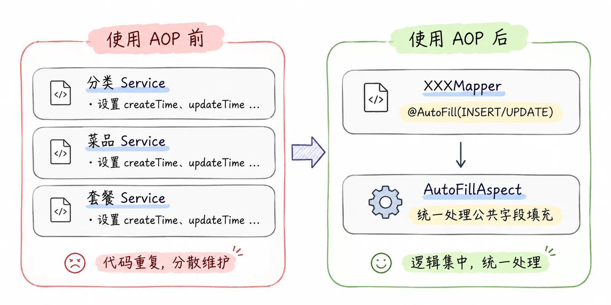
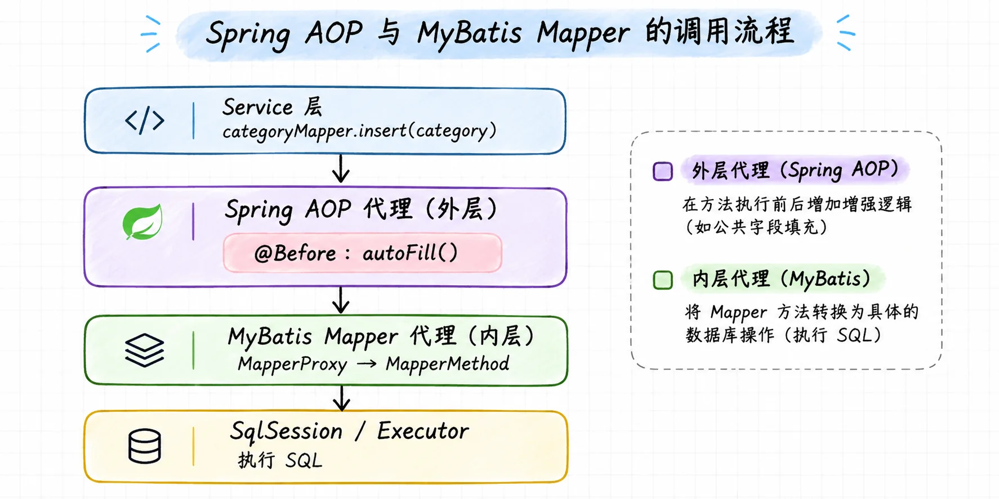
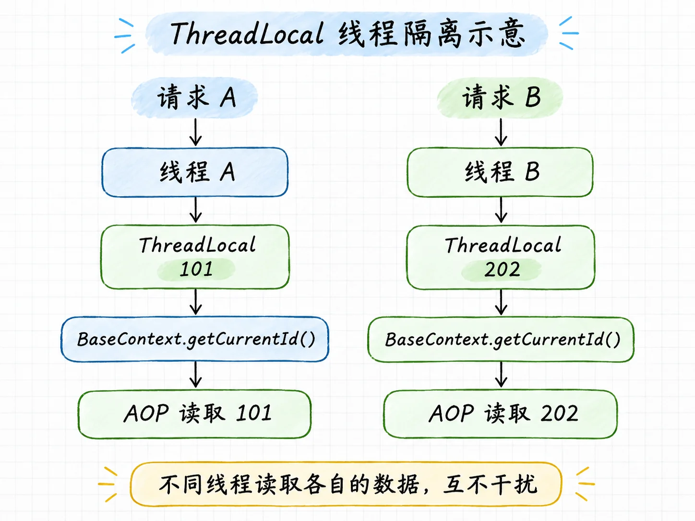

在学习苍穹外卖项目时，我接触到了一个挺实用的功能——**公共字段自动填充**。原本需要在 Service 层手动设置的创建时间、修改时间等字段，可以通过 **Spring AOP** 统一处理。

> **为什么只需要在 Mapper 方法上添加一个注解，就能在执行 SQL 之前自动填充实体对象中的字段？**

要弄清楚这个问题，我们需要看看 Spring AOP 是如何拦截方法调用的，以及它背后的动态代理机制。

## 一、从公共字段自动填充说起

在苍穹外卖项目中，员工、分类、菜品、套餐等数据表都有几个相同的字段：

- `createTime`：创建时间
- `updateTime`：修改时间
- `createUser`：创建人
- `updateUser`：修改人

以新增分类为例，如果直接在 Service 层处理，就需要编写下面这段代码：

```java
category.setCreateTime(LocalDateTime.now());
category.setUpdateTime(LocalDateTime.now());
category.setCreateUser(BaseContext.getCurrentId());
category.setUpdateUser(BaseContext.getCurrentId());

categoryMapper.insert(category);
```

这段代码并不复杂，但问题在于，其他业务模块同样需要维护这些字段。如果每个新增、修改方法都手动赋值，不仅会出现大量重复代码，还可能因为忘记设置某个字段而产生问题。这里的 `BaseContext.getCurrentId()` 用于获取当前登录用户的 ID。它与项目中使用的 `ThreadLocal` 有关，后面分析自动填充的具体实现时再详细介绍。

因此，我们可以考虑把这些重复操作抽取出来，统一处理。



在苍穹外卖项目中，我们通过 **Spring AOP** 配合自定义注解，将公共字段的填充逻辑集中到了切面中。

例如，在 `CategoryMapper` 中，可以看到这样的代码：

```java
@AutoFill(value = OperationType.INSERT)
void insert(Category category);

@AutoFill(value = OperationType.UPDATE)
void update(Category category);
```

这里的 `@AutoFill` 是项目自定义的注解，`OperationType.INSERT` 和 `OperationType.UPDATE` 分别表示新增和修改操作。

> **注意：`@AutoFill` 本身只是一个标记，并不会自动修改实体对象。**

那么，Spring 是如何识别这个注解，并在 Mapper 方法执行前调用填充逻辑的呢？这就需要从 Spring AOP 的切面、切点和通知说起。

## 二、Spring AOP 的核心概念

前面提到，`@AutoFill` 本身并不会执行公共字段填充。真正负责这项工作的是项目中的 `AutoFillAspect`。

先来看一下其中的核心代码：

```java
@Aspect
@Component
public class AutoFillAspect {

    @Pointcut("execution(* com.sky.mapper.*.*(..)) && @annotation(com.sky.annotation.AutoFill)")
    public void autoFillPointcut() {}

    @Before("autoFillPointcut()")
    public void autoFill(JoinPoint joinPoint) {
        // 获取操作类型及方法参数
        // 通过反射填充公共字段
    }
}
```

这里涉及 **Spring AOP** 的三个重要概念：

| 概念             | 对应项目代码                  | 作用                       |
| ---------------- | ----------------------------- | -------------------------- |
| 切面（Aspect）   | `AutoFillAspect`              | 将公共字段填充逻辑集中管理 |
| 切点（Pointcut） | `autoFillPointcut()`          | 决定哪些方法需要增强       |
| 通知（Advice）   | `@Before` 标注的 `autoFill()` | 在目标方法执行前填充字段   |

其中，`@Aspect` 用于标识切面，`@Component` 则让 Spring 将这个类注册为 Bean。

### 1. 切点表达式是怎么匹配方法的？

我们重点看一下项目中的切点表达式：

```java
@Pointcut("execution(* com.sky.mapper.*.*(..)) && @annotation(com.sky.annotation.AutoFill)")
```

它包含两个条件：

- `execution(* com.sky.mapper.*.*(..))`：匹配 `com.sky.mapper` 包下各类型中的方法，不包含子包。
- `@annotation(com.sky.annotation.AutoFill)`：要求方法上存在 `@AutoFill` 注解。

中间的 `&&` 表示两个条件必须同时满足。

例如，之前的 `CategoryMapper.insert()` 标注了 `@AutoFill`，也符合 Mapper 包的匹配条件，因此能够被这个切点匹配。

### 2. 匹配成功之后会发生什么？

```java
@Before("autoFillPointcut()")
public void autoFill(JoinPoint joinPoint) {
    // 公共字段填充逻辑
}
```

这里的 `@Before` 是前置通知。当目标方法符合切点条件时，Spring AOP 会在目标方法执行之前调用 `autoFill()`。

通过 `JoinPoint`，我们可以获取当前方法的相关信息及参数，再利用反射修改实体对象中的公共字段。

> **切面组织公共逻辑，切点决定增强哪些方法，通知决定在什么时机执行什么操作。**

不过，到这里还有一个问题：我们并没有在 `CategoryMapper.insert()` 中主动调用 `autoFill()`，Spring 为什么能让这段通知先执行？

答案就在 Spring AOP 的核心实现机制——**动态代理**。

## 三、Spring AOP 为什么能拦截 Mapper 方法？

前面我们已经知道，`@Before` 可以让公共字段填充逻辑在目标方法执行前运行。

但问题是，我们在 Service 层调用的明明是：

```java
categoryMapper.insert(category);
```

既没有手动调用 `autoFill()`，也没有修改 `insert()` 的实现，Spring 是怎么把这段逻辑插进来的？

答案就是——**动态代理**。

### 1. 先理解什么是代理

假设我们需要调用一个方法，但又希望在方法执行前后增加一些额外操作。最直接的做法，就是让调用方先经过一个代理对象，再由代理对象调用原来的方法。

这样既能保留原有方法的功能，也不需要直接修改它的实现。

在苍穹外卖中，Service 调用 `CategoryMapper.insert()` 时，Spring AOP 可以让调用先经过代理对象，执行匹配的 `@Before` 通知，然后再交给原来的 Mapper 对象处理。

整个过程可以简单理解为：



从图中可以看出，Spring AOP 和 MyBatis 的代理实际上负责不同的事情：Spring AOP 负责在 Mapper 方法执行前插入公共字段填充逻辑，而 MyBatis Mapper 代理负责处理接口方法对应的数据库操作。

此外，`autoFill()` 修改的是传入的实体对象本身。通知执行完成后，MyBatis 继续使用这个对象，因此能够读取到修改后的字段值。

> **调用方并不是主动执行了切面方法，而是代理对象在调用原方法之前，先执行了对应的增强逻辑。**

不过，`CategoryMapper` 本身是一个接口，我们并没有编写它的实现类。那么 Spring AOP 代理最终调用的 Mapper 对象又是谁创建的？

这就涉及 MyBatis 自身的动态代理机制。

### 2. 为什么 Mapper 接口没有实现类也能执行 SQL？

这是因为 **MyBatis 会在运行时为 Mapper 接口创建动态代理对象**。当我们调用 `CategoryMapper.insert()` 时，代理对象会根据方法对应的 SQL 映射信息，交给 MyBatis 执行数据库操作。

也就是说，Spring AOP 和 MyBatis 虽然都使用了动态代理，但各自负责不同的事情。

到这里，我们已经知道 Spring AOP 是如何通过代理机制，在 Mapper 方法执行前调用 `autoFill()` 的。

但要真正实现公共字段自动填充，还有两个问题没有解决：

- **数据从哪里来？** 比如当前登录用户的 ID。
- **数据怎么填进去？** 切面如何找到实体对象，并修改其中的字段？

接下来，我们结合 `AutoFillAspect` 的具体代码，把整个过程串起来。

## 四、公共字段自动填充是如何实现的？

前面我们已经知道，Spring AOP 能在 Mapper 方法执行前调用 `autoFill()`。

但要完成公共字段自动填充，首先得知道这些字段的值从哪里来。

### 1. 公共字段的值从哪里来？

回顾一下，项目中需要自动填充的四个字段，其实有两种不同的数据来源：

| 字段                       | 数据来源                                          |
| -------------------------- | ------------------------------------------------- |
| `createTime`、`updateTime` | `LocalDateTime.now()`，获取当前时间               |
| `createUser`、`updateUser` | `BaseContext.getCurrentId()`，获取当前登录用户 ID |

时间比较容易获取，但登录用户的 ID 是怎么拿到的呢？

这里就涉及 Java 的 **ThreadLocal**。

**（1）ThreadLocal 是什么？**

简单来说，`ThreadLocal` 可以让每个线程保存一份**属于自己的数据**。不同线程之间的数据**互不干扰**。

用图来理解会更直观一些：



也就是说，不同请求虽然都会调用 `BaseContext.getCurrentId()`，但由于它们运行在线程各自的 `ThreadLocal` 中，因此读取到的是各自独立的用户 ID。

在苍穹外卖项目中，我们使用 `BaseContext` 封装了 `ThreadLocal`：

```java
public class BaseContext {

    private static ThreadLocal<Long> threadLocal = new ThreadLocal<>();

    public static void setCurrentId(Long id) {
        threadLocal.set(id);
    }

    public static Long getCurrentId() {
        return threadLocal.get();
    }
}
```

这里主要关注两个方法：

- `setCurrentId()`：把当前用户 ID 保存到当前线程的 `ThreadLocal` 中。
- `getCurrentId()`：从当前线程的 `ThreadLocal` 中取出用户 ID。

**（2）用户 ID 是什么时候保存进去的？**

答案是在 **JWT 登录校验拦截器** 中。

当用户携带 JWT 访问需要身份校验的接口时，拦截器会校验 Token，解析出用户 ID，并将其保存到当前线程：

```java
BaseContext.setCurrentId(empId);
```

之后，请求进入 Controller、Service，并最终调用 Mapper 方法。

当 Spring AOP 执行 `autoFill()` 时，就可以通过：

```java
Long currentId = BaseContext.getCurrentId();
```

读取之前保存的用户 ID。

这是因为在正常的同步请求处理过程中，拦截器和切面运行在同一个请求处理线程中，因此能够访问同一份 `ThreadLocal` 数据。

整个过程可以理解为：

**JWT 拦截器解析用户 ID → ThreadLocal 保存 → AOP 切面读取 → 填充创建人或修改人**

> **ThreadLocal 保存的不是实体对象，也不是所有公共字段，而是当前线程对应的用户 ID。**

需要注意的是，实际使用 `ThreadLocal` 时，还应该在请求处理结束后调用 `remove()` 清理数据，避免线程池复用时出现数据残留。

到这里，我们已经知道了公共字段的数据来源。

不过，新增和修改操作需要填充的字段并不完全相同。接下来看看 `autoFill()` 是如何通过 `@AutoFill` 注解判断操作类型的。

### 2. 如何通过 `@AutoFill` 判断新增和修改操作？

前面已经解决了公共字段的数据来源，但还有一个问题：**新增和修改操作需要填充的字段并不完全相同。**

| 操作类型       | 需要填充的字段                                         |
| -------------- | ------------------------------------------------------ |
| INSERT（新增） | `createTime`、`createUser`、`updateTime`、`updateUser` |
| UPDATE（修改） | `updateTime`、`updateUser`                             |

新增数据时，需要同时记录创建信息和修改信息；而修改已有数据时，只需要更新修改时间和修改人，原来的创建信息应该保留。

那么，`autoFill()` 怎么知道当前执行的是新增还是修改呢？

答案就在之前使用的 `@AutoFill` 注解中。

**（1）先看自定义注解的定义**

```java
@Target(ElementType.METHOD)
@Retention(RetentionPolicy.RUNTIME)
public @interface AutoFill {
    OperationType value();
}
```

这里主要关注三个地方：

- `@Retention(RetentionPolicy.RUNTIME)`：表示注解在程序运行时依然可以被读取。
- `OperationType value()`：定义了一个注解属性，用来保存操作类型。
- `@Target(ElementType.METHOD)`：表示 `@AutoFill` 只能标注在方法上。

因此，当我们在 Mapper 方法上编写：

```java
@AutoFill(value = OperationType.INSERT)
```

就相当于给这个方法标记了一个新增操作类型。

不过，**注解只负责保存信息，真正读取这些信息的仍然是 AOP 切面。**

**（2）在切面中读取操作类型**

回到 `AutoFillAspect`，我们可以通过下面几行代码获取注解中的操作类型：

```java
MethodSignature signature = (MethodSignature) joinPoint.getSignature();

AutoFill autoFill = signature.getMethod()
        .getAnnotation(AutoFill.class);

OperationType operationType = autoFill.value();
```

逐步来看：

1. `joinPoint.getSignature()`：获取当前被拦截方法的签名信息，并转换为 `MethodSignature`。
2. `signature.getMethod()`：获取对应的 `Method` 对象，再通过 `getAnnotation()` 读取方法上的 `@AutoFill` 注解。
3. `autoFill.value()`：读取注解中保存的操作类型。

例如，当执行 `CategoryMapper.insert()` 时，读取到的就是 `OperationType.INSERT`；执行 `update()` 时，读取到的则是 `OperationType.UPDATE`。

> **`@AutoFill` 负责标记操作类型，Spring AOP 负责拦截方法并读取注解，最终由切面根据操作类型执行对应的填充逻辑。**

到这里，我们已经知道了字段的值从哪里来，也知道了应该填充哪些字段。

但还有一个问题：**切面怎样拿到 `Category` 实体对象，并修改它的属性呢？**

接下来就需要用到 `JoinPoint` 获取方法参数。

### 3. JoinPoint 如何获取需要填充的实体对象？

在 Service 层调用 `categoryMapper.insert(category)` 时，我们会传入一个 `Category` 对象。

但切面方法 `autoFill(JoinPoint joinPoint)` 并没有直接接收 `Category` 参数，那么它是怎么拿到这个对象的呢？

答案就是 **JoinPoint**。

**（1）通过 JoinPoint 获取方法参数**

`JoinPoint` 表示当前被 AOP 拦截的方法调用，我们可以通过它获取方法信息、传入的参数等。

在项目中，只需要下面一行代码：

```java
Object entity = joinPoint.getArgs()[0];
```

拆开来看：

- `joinPoint.getArgs()`：返回当前方法的参数数组，类型为 `Object[]`。
- `[0]`：取出数组中的第一个参数，也就是传入的 `category` 对象。
- `Object entity`：使用 `Object` 类型接收参数，方便切面处理不同类型的实体对象。

例如，执行 `categoryMapper.insert(category)` 时，`getArgs()[0]` 获取的就是调用时传入的 `Category` 对象。

这里需要注意，**当前代码默认 Mapper 方法的第一个参数就是需要填充的实体对象**。

**（2）为什么修改 entity 就能影响数据库操作？**

这里涉及 Java 的一个基础知识：**Java 传递对象参数时，传递的是对象引用的值，而不是复制一个新的对象。**

因此，`entity` 和 Service 层传入的 `category` 实际上指向同一个对象。

只要通过 setter 修改 `entity` 的属性，原来的 `category` 对象也就发生了变化，后续 MyBatis 执行数据库操作时，自然能够读取到修改后的字段值。

不过需要区分：**修改对象的属性，并不等于让变量指向一个新对象。**

例如：

```java
entity = new Category();
```

这只是让局部变量 `entity` 指向一个新对象，并不会替换原来传入 Mapper 方法的 `category` 参数。

而通过反射调用原对象的 setter，修改的仍然是同一个对象的属性。

> **JoinPoint 负责获取需要填充的实体对象，真正完成字段赋值的则是 Java 反射。**

现在，操作类型、字段值和需要修改的实体对象都已经准备好了。接下来只需要通过 Java 反射调用对应的 setter 方法，就能完成公共字段填充。

### 4. 反射是如何完成公共字段赋值的？

通过 `JoinPoint` 拿到实体对象后，接下来需要把公共字段的值写进去。

如果只处理 `Category`，直接调用 setter 就可以。但项目中还有员工、菜品、套餐等不同类型的实体，因此我们需要一种通用的赋值方式。

所以项目使用了 **Java 反射**，根据方法名称找到对应的 setter，再调用它们。

**（1）找到 setter 方法**

以 UPDATE 操作为例，切面中通过 `getDeclaredMethod()` 获取实体类中的 setter：

```java
Method setUpdateTime = entity.getClass().getDeclaredMethod(
        AutoFillConstant.SET_UPDATE_TIME, LocalDateTime.class);

Method setUpdateUser = entity.getClass().getDeclaredMethod(
        AutoFillConstant.SET_UPDATE_USER, Long.class);
```

这里的 `entity.getClass()` 用于获取实体对象的类型，而 `getDeclaredMethod()` 会根据**方法名称和参数类型**查找方法。

例如，`getDeclaredMethod("setUpdateTime", LocalDateTime.class)` 就是在查找参数类型为 `LocalDateTime` 的 `setUpdateTime()` 方法。

查找成功后，返回一个 `Method` 对象。此时只是找到了方法，还没有真正修改字段。

**（2）通过 invoke() 完成赋值**

拿到 `Method` 对象之后，就可以执行对应的 setter：

```java
LocalDateTime now = LocalDateTime.now();
Long currentId = BaseContext.getCurrentId();

setUpdateTime.invoke(entity, now);
setUpdateUser.invoke(entity, currentId);
```

`invoke()` 的第一个参数是要操作的对象，后面的参数则是调用方法时需要传入的值。

假设 `entity` 指向一个 `Category` 对象，那么：

```java
setUpdateTime.invoke(entity, now);
```

就相当于直接执行 `category.setUpdateTime(now)`。

区别在于，**反射不需要提前把实体类型写死在代码中**。只要对象具有符合要求的 setter，就可以使用相同的逻辑完成赋值。

对于 INSERT 操作，同样通过反射调用对应的 setter，只不过需要填充四个公共字段。

**（3）一个容易踩的坑：反射参数类型不匹配**

我在练习时就遇到过一个问题：使用 `getDeclaredMethod()` 查找 setter 时，把 `LocalDateTime.class` 误写成了 `LocalDate.class`。

假设实体类中的方法是：

```java
public void setCreateTime(LocalDateTime createTime)
```

那么反射查找时就必须使用 `LocalDateTime.class`。如果写成 `LocalDate.class`，Java 找不到对应的方法，就会抛出 `NoSuchMethodException`。

这也是反射与直接调用 setter 的一个区别：直接调用时，不匹配的参数类型通常能在编译阶段发现；通过反射查找方法时，这类错误往往要到运行时才会暴露。

## 五、写在最后

刚开始学习公共字段自动填充时，我只觉得它省去了 Service 层重复设置字段的代码。后来仔细看了 `AutoFillAspect` 的实现，才逐渐理解了 Spring AOP、动态代理、注解和反射是怎样配合工作的。

其中让我印象比较深的是，`@AutoFill` 本身并不会执行任何填充操作，它只是提供了一个标记。真正的处理逻辑都集中在切面中，这样既减少了重复代码，也方便后续统一维护。

当然，这种实现方式也有一些需要注意的地方。比如，当前切面默认 Mapper 方法的第一个参数是实体对象，而反射查找 setter 时，方法名称和参数类型也必须匹配。

通过这个案例，我对 AOP 的理解不再只是“在方法执行前后添加一些操作”，而是看到了它在实际业务中如何帮助我们抽取公共逻辑。